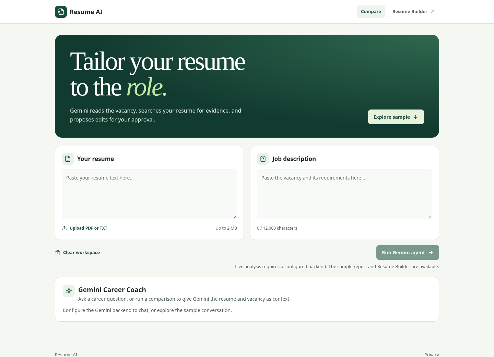
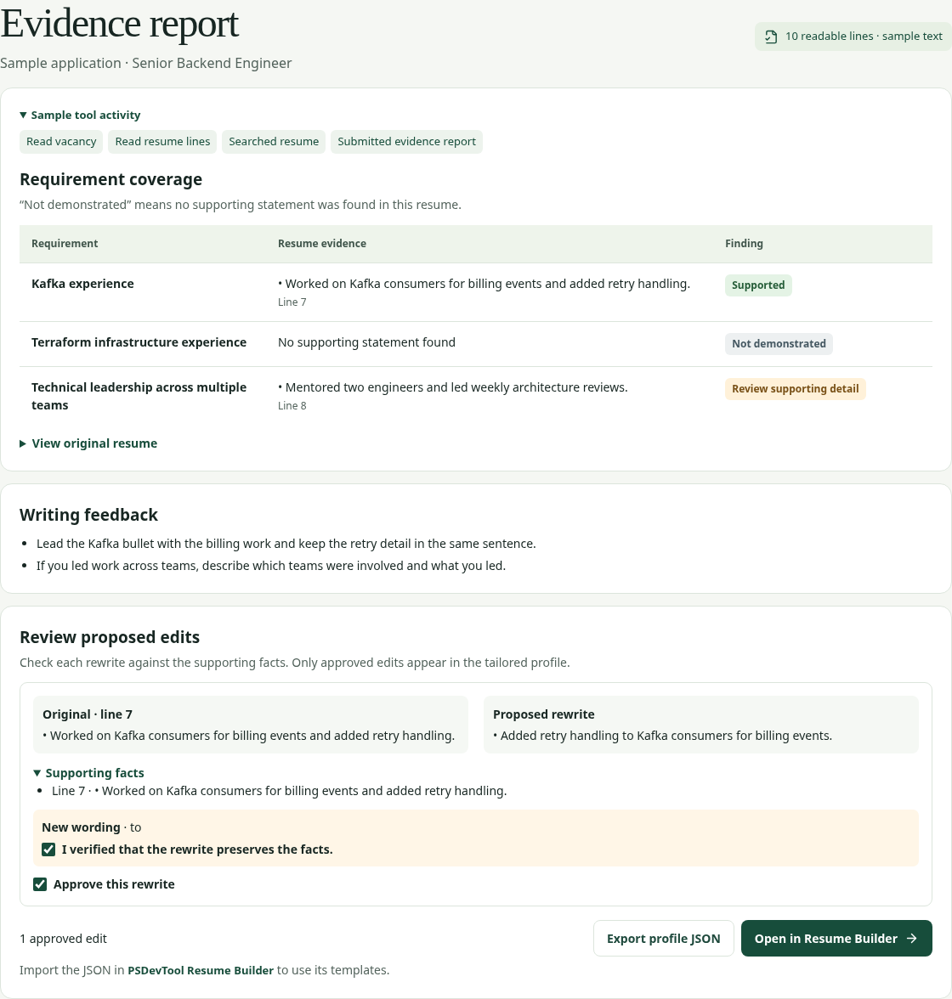
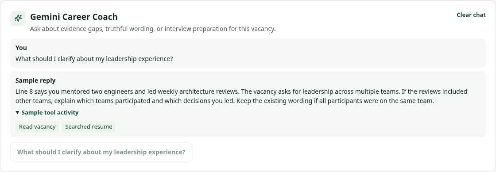
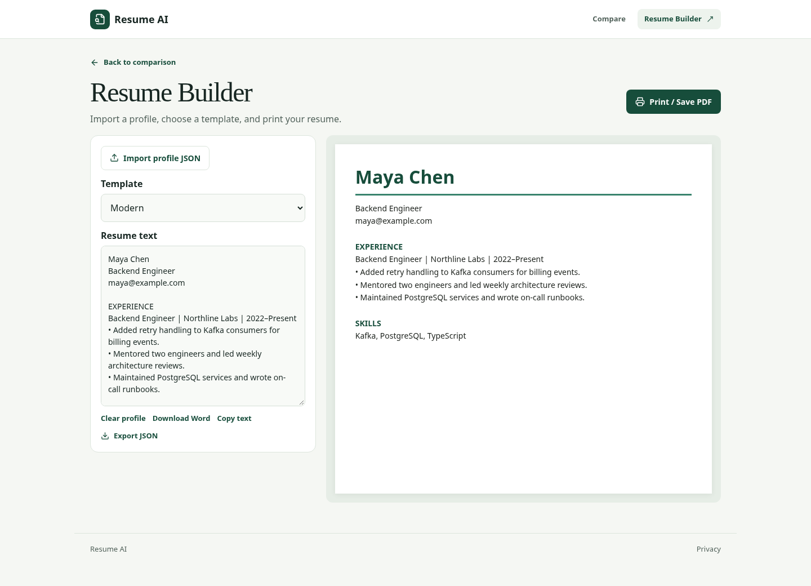

# Resume AI

Resume AI is a Gemini-powered application assistant. Gemini reads a vacancy, retrieves evidence from the resume using function calls, and submits a validated report. Review the agent’s tool activity, ask the Gemini Career Coach follow-up questions, and approve rewrites before exporting a tailored profile.

## Try the workflow

1. Run the frontend and select **Explore sample** to load a fictional resume, vacancy, and report. The sample works without cloud credentials.
2. Review the sample tool activity and try the leadership question in **Gemini Career Coach**. For a live run, provide both documents and select **Run Gemini agent**.
3. Review **Requirement coverage**. **Supported** points to direct evidence. **Review supporting detail** calls out partial or ambiguous evidence. **Not demonstrated** means the resume contains no supporting statement for that requirement.
4. Read the original line, proposed rewrite, and cited facts. Confirm flagged changes and approve only the rewrites you want in the tailored copy.
5. Select **Export profile JSON**. In [PSDevTool Resume Builder](https://psdevtool.online/resume/), choose a template, then use **Edit resume → Save & backup → Import profiles / draft → Done editing**. Review the imported fields and select **Print / Save PDF**. You can also open the tailored copy directly in Resume AI’s builder for local template selection, printing, Word export, or plain-text copy.

## Screenshots

### Compare a resume and vacancy



### Review evidence and approve changes



### Ask Gemini about a gap



### Preview and print a tailored resume



## Local development

Use Node.js 22.12 or later for the frontend. The Firebase Functions runtime is pinned to Node.js 22.

```sh
npm ci
npm ci --prefix functions
npm run dev
```

```sh
npm run lint
npm test
npm run build
```

The production frontend is generated in `dist/`. For local production smoke tests, run `npm run preview`.

## Enable live analysis

1. In a Firebase project on a Functions-supported billing plan, register a web app and enable **Anonymous** sign-in in Firebase Authentication.
2. Enable Vertex AI in that Google Cloud project and grant the Functions runtime service account access to invoke the configured Vertex model, for example with the Vertex AI User role.
3. Copy `functions/.env.example` to `functions/.env`. Set `ALLOWED_ORIGINS` to the comma-separated browser origins that will use the function. The defaults use Gemini 3.8 Flash at the global endpoint. If you change the model, use a Gemini model with function calling available in your project and location.
4. Deploy the function with `firebase deploy --only functions:analyzeResume,functions:chatWithGemini --project YOUR_PROJECT_ID` using the Firebase CLI. Firebase sets the Cloud project ID in the function environment.
5. Copy `.env.example` to `.env.local`. Set `VITE_ANALYSIS_URL` to the deployed HTTPS `analyzeResume` URL. Set `VITE_COACH_URL` if the deployed coach URL differs from the sibling `chatWithGemini` URL. Specify the Firebase web app’s API key and project ID. Restart the dev server or rebuild after changing these variables. To host the resulting build on Firebase Hosting, run `firebase deploy --only hosting --project YOUR_PROJECT_ID`.

If upgrading from the original app, remove the retired `getPresignedUrl` function and review retention for its existing bucket objects and Firestore records. Deploy both current functions to replace the old client-ID-based assistant.

## What the Gemini agent does

The analysis agent chooses among `read_vacancy`, `read_resume_lines`, and `search_resume` before calling `submit_report`. The server runs these read-only tools against the current request and verifies that cited lines were actually returned by tools. The Career Coach uses the same read tools when discussing an application and can answer general career questions without documents. The app shows the tools actually run and keeps rewrite approval and export under user control. Each turn is bounded by a tool-call and model-turn budget. The sample shows a prerecorded run and reply.

## Analysis and data handling

- Live requests carry a Firebase ID token. The function verifies the token before processing. It accepts pasted text or inline file bytes and rejects caller-supplied UIDs and storage paths.
- PDF and UTF-8 text uploads are limited to 2 MB. PDFs can have up to 12 pages. Extracted or pasted resumes can have up to 30,000 characters, and vacancies can have up to 12,000. Scanned PDFs without a text layer need OCR or pasted text.
- The browser displays a processing state while the request is pending. The function returns a completed report or a structured failure with a retry indicator. Model schema and source-reference checks reject malformed output, invented vacancy citations, and out-of-range resume lines. Evidence matching and wording still require human judgment.
- The current workflow keeps chat, documents and reports in browser memory and processes attachments in request memory. It writes no documents or analysis reports to Firestore, a bucket, or a temporary file. **Remove file**, **Clear workspace**, and **Clear profile** clear the relevant browser data. Live requests send document text to Vertex AI, which is subject to the configured project’s service terms and settings.
- Export uses PSDevTool’s version 1 draft schema. Common headings, skills and role/company/date lines map into template fields, while unrecognized text is preserved in the summary or additional entries. The `resumeAi.text` field preserves the full tailored text for reimport into Resume AI. Check field placement after importing resumes with unusual layouts.
